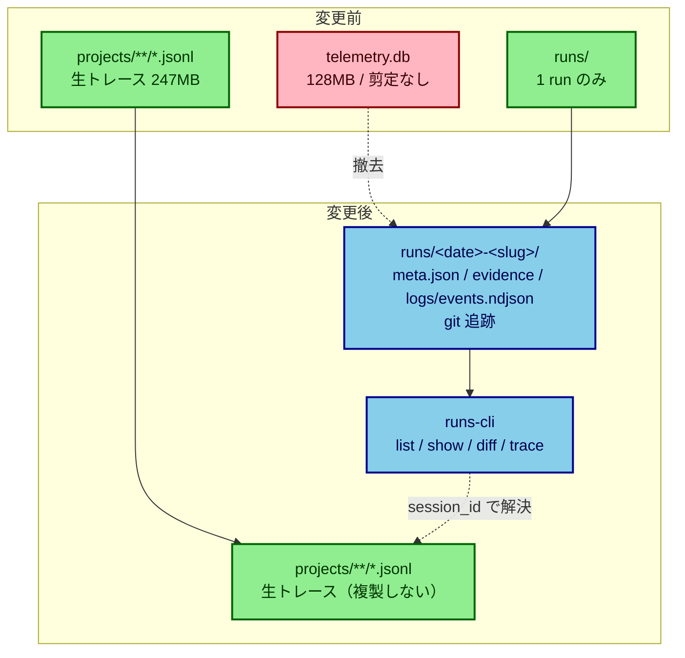

# ログを JSON に寄せ、SQLite を撤去する

日付: 2026-08-18

## Objective

実行履歴の記録先を JSON（既存のトランスクリプト + `runs/`）に一本化し、
`telemetry/telemetry.db` を撤去する。

## なぜ今これか

tool 呼び出しが**三重**に記録されていた。`projects/**/*.jsonl`（Claude Code 自身が書く、
234ファイル / 247MB）、`session_events`（37,498行）、`tool_executions`（37,732行 / 94MB）。
SQLite 側 128MB は、既に JSON で存在するものの複製だった。剪定・ローテーションはコード上に0件で、
成長は加速中（4月 2,423行 → 8月 13,089行）。

しかも**信号の質は JSON の方が高い**。`tool_executions.status` は `started`/`completed` の
2値しか書かれず（`failed` は一度も書かれない）、`eval-aggregates.js:125` が
`started - completed` の差を「失敗らしきもの」と推定している。トランスクリプトは `is_error` を
実際に持ち（false 882 / true 17）、`tool_use_id` で呼び出しと結合でき、エラー本文も入る。

そして最も重い問題。**完了ゲートの証拠は毎回破棄されている。**
`.gitignore:43-50` が3種の証拠を除外し、worktree 内に書かれるので `ExitWorktree` で消える。
SQLite に残るのは2行の抜粋と、存在しないパスを指す `evidence_ref` だけ。
`verify` / `review` / `observe` は動いて、証拠を作って、証拠を捨てている。

Meta-Harness 論文（arXiv 2603.28052）Table 3 の ablation は、提案者に生トレースを見せた場合
（median 50.0）が、スコアのみ（34.6）やスコア+要約（34.9）を大きく上回ることを示している。
要約は失われた信号を回復せず、診断に必要な細部を潰して害になりうる。
**この harness は今その要約側に立っている。**

## Non-goals

- `task-artifacts.js` の `buildLifecycleState`（波及195箇所）は触らない。2026-08-17 に決めた境界
- 生トレース 247MB を `runs/` に複製しない。`session_id` で解決できれば結合は足りる
- `session-env/`（237ディレクトリ）・`sessions/`（258ファイル）・`file-history/`（1,370ファイル）は対象外
- 新しいテーブルや新しいストアを作らない。`runs/` の器は既存（`pipeline-runner.js:171-215`）
- ログの保持期間ポリシーは決めない（トランスクリプトは Claude Code 側の管理物）

## 触る対象

| 対象 | 変更内容 | 壊す可能性のあるもの |
|---|---|---|
| `scripts/lib/eval-aggregates.js` | `toolFailureRate()` を transcript 読みに。`status==='failed'` 分岐を撤去 | `/eval-batch` の出力形。`byTool` の形は保つ |
| `scripts/hooks/telemetry-{pre,post}-tool.js` | `tool_executions` と tool イベントの記録をやめる | 他の hook がこの行を前提にしていないか |
| `scripts/lib/run-record.js`（新設） | `runs/<YYYY-MM-DD>-<slug>/` に `meta.json` + `evidence/*.json` + `logs/events.ndjson`。階層とイベント型は既存の `pipeline-runner.js` に揃え、`pipeline-evidence.js` が探す `pipeline_started` 系と衝突させない。run-id は design doc と同じ slug | `pipeline-evidence.js` の run 走査 |
| `scripts/lib/session-trace.js` | `memory_episodic` INSERT 撤去 → Phase 4 で DB 層全体 | 1,521行。読み手6箇所 |
| `scripts/lib/{telemetry-health,harness-status}.js` | 読み先を JSON へ | `/health-status` `/trace-status` `/next-action` |
| **契約: `.gitignore:26`** | `runs/` を追跡対象にする | コミット差分にログが載る |
| **契約: `session_events.event_type`** | 語彙から tool 系を落とす | `VALID_EVENTS` を参照する検証 |
| **契約: `evidence_ref`** | パス参照から**本文同梱**へ | 要約に潰さないこと（Table 3 の教訓） |
| `docs/architecture.md:14` | 状態の置き場所の記述 | **各 Phase の着地時点の事実に合わせる。先に書かない** |

## 却下した案

- **SQLite を残して JSON を併記する** — 四重トレースになる。「読み手のいないストアを作らない」に反する
- **トランスクリプトを `runs/` にコピーする** — 247MB を複製する理由が無い。`session_id` で解決できる
- **`runs/` を gitignore のまま置く** — 証拠を守るのが目的なのに、マシンを失えば消える。
  `CLAUDE.md` が「復帰の根拠は git」と定めているのと揃わない
- **要約だけを JSON にする** — Table 3 が最弱と測定した条件をフォーマットだけ変えて再現することになる

## Open Issues

- **Phase 3 / 4 未着手。SQLite は生きている。** 重複記録と証拠破棄は止まったが、
  `telemetry-health` / `harness-status` / `formatTraceStatus` / `eval-aggregates` の残りは
  まだ SQLite を読む。壊れてはいないが「撤去する」目的は未達
- **Phase 3 に JSON 側で再導出できない項目が1つある。** `human_intervention_count` は
  `session_events` の metadata から積算されており、トランスクリプトからの導出方法が未確定
- **トランスクリプトの保持期間は Claude Code 側の管理で、harness は制御できない。**
  実測で最古のレコードは 2026-07-23、SQLite は 2026-04-22 から。`tool_executions` 37,843行の
  うち **16,559行（44%）はトランスクリプトに存在しない期間**。読み手が使う窓は7日なので
  実害は無いが、Phase 4 で DB を消す前に日次ロールアップの書き出しが必要（当初計画に無かった）
- harness リポジトリ以外での作業の run record は `$HOME/.claude/runs/` に落ちるが、
  `main` へ直接コミットできない（規律）ため次の harness タスクまで未コミットで残る
- NDJSON の並行追記。「4096バイト超の行を書かない」で回避する想定。
  interleave を実際に観測したら per-session ファイル分割に変える（**推定**）
- **テストが実 `runs/` を汚す経路が3層あった。** `dbPath` が SQLite しか退避していない、
  harness 判定がパス形状だけを見ていた、`HOME` も `dbPath` も退避しないテストが4本。
  3手で塞いだが、機械的な検査は無い（`review-summary.md` の Guardrail Candidates）
- `verification_results` 202行のうち95行が `run_id = test-session-abc12345`。
  Phase 4 の書き出し時に印を付けて分離する。実 DB に書く経路の特定は未着手
- `runs/` を git 追跡にしたので、`pipeline-runner` / `task-queue` が書く既存の
  `runs/run-<task>-<hash>/` も追跡対象に入る

## 構成の変化

`docs/architecture.md` は**各 Phase の着地時点で**直す。SQLite が実際に消えるのは Phase 4 なので、
それより前に「JSON 一本化済み」と書かない。文書が実装を先取りする状態を作らないため。
