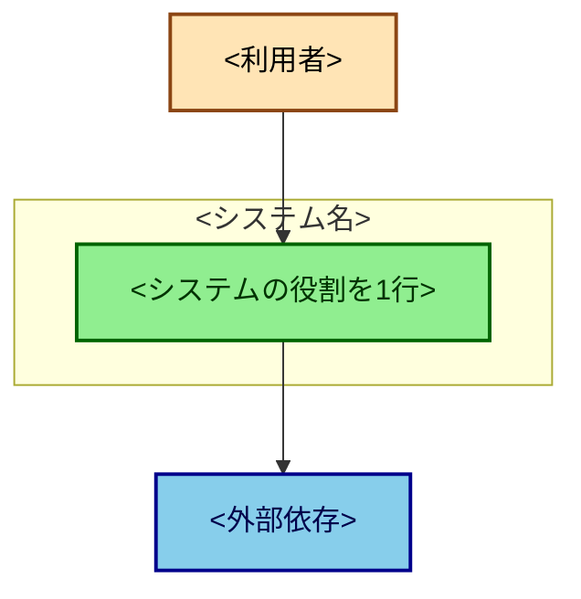
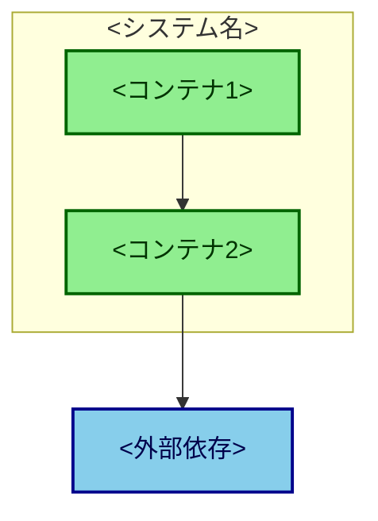

<!--
architecture.md = 「今どうなっているか」。第三者が2番目に読む「これだけ見とけ」ドキュメント。

このリポジトリで唯一、維持義務があるファイル。維持されるための条件:
  1. 維持義務はこの1ファイルだけ（分散させると守られない）
  2. 更新トリガー = docs/design/ に1枚書く時に、セットで直す
     （構成が変わる = design doc を書く。書かない変更では構成も変わらない）
  3. 薄く保つ（A4 1〜2枚）。厚いと直さなくなる

薄く保つための鉄則:
  - what だけ書く。why は docs/design/ にある。why を書くと厚くなり腐る
  - C4 は Context と Container まで。Component 以下は変化が速いので書かない
  - 値（ID・ドメイン・パス）を書かない。コードか設定が正本
  - 契約（型・スキーマ・列定義）を書かない。コードが正本

腐り検知: エージェントに「architecture.md とコードが一致しているか確認して」と投げる。
生成させるのではなく検証させる（正しさの責任は人が持つ）。
-->

# Architecture

最終更新: YYYY-MM-DD
<!-- 更新は docs/design/ に1枚書く時とセット -->

## デプロイ単位

<!-- 「1リポジトリだが独立してデプロイされるものが N 個ある」を最初に示す。 -->

| デプロイ単位 | ディレクトリ | 実行環境 | 役割 |
|---|---|---|---|
|  |  |  |  |

## C4 — System Context

<!-- 誰が使い、外部の何に依存するか。絵文字は使わない。classDef で種別を区別する。 -->

## C4 — Container

<!-- システム内部の実行単位と外部依存への線。Component 以下には踏み込まない。 -->

## 正本の在り処

<!-- 事実をここに書き写さず、どこが正本かだけ示す。 -->

| 知りたいこと | 正本 |
|---|---|
| 契約（req/res・スキーマ・列定義） | コード（型定義） |
| 設定値（ID・ドメイン） |  |
| なぜこの構成か | `docs/design/` |
| デプロイ手順 | `docs/how-to/deployment.md` |
