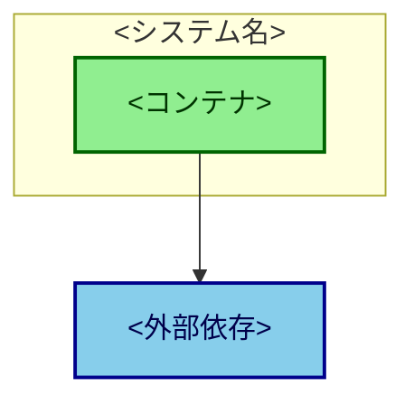

<!--
機能追加1件ごとの design doc。追加only。書いたら二度と書き換えない。
ファイル名: docs/design/YYYY-MM-DD-<slug>.md （日付順に並ぶので連番は振らない）

A4 1枚に収める。この制約が本体。
1枚に収めようとすれば節を選ばざるを得ないので、選択が強制される。
書くコストが低いから実際に書かれる、というのが継続の条件。

全体像・用語・アーキテクチャ全体は初回 design doc にあるので繰り返さない。差分だけ書く。

構成（デプロイ単位）が変わる回は、C4 図を1枚入れ、docs/architecture.md もセットで直す。
構成が変わらない回は図を入れない。
-->

# <変更のタイトル>

日付: YYYY-MM-DD
著者:

## Objective

<!-- 1文。何を実現するか。 -->

## なぜ今これか

<!-- 2〜3行。何が困っていて、この変更で何が変わるか。 -->

## Non-goals

<!-- ペラ1でもここは削らない。スコープ膨張を止めるのが一番安い。 -->

-

## 触る対象

<!--
既存システムへの追加では最重要の節。初回 design doc には無い項目。
特に「どの契約に触るか」を明示する。契約を変えると別のものが壊れる。
-->

| 対象 | 変更内容 | 壊す可能性のあるもの |
|---|---|---|
| コンポーネント |  |  |
| 契約（型・スキーマ・イベント名） |  |  |

## 却下した案

<!-- 1行ずつ。1〜2個。 -->

-

## Open Issues

-

<!--
構成が変わる場合のみ、以下に C4 Container 図を1枚入れる。絵文字は使わない。
入れたら docs/architecture.md も同じ内容に直す（セットで動かす）。

-->
