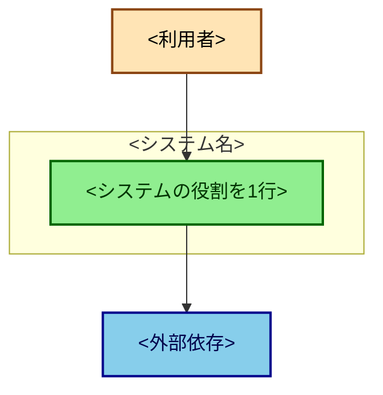
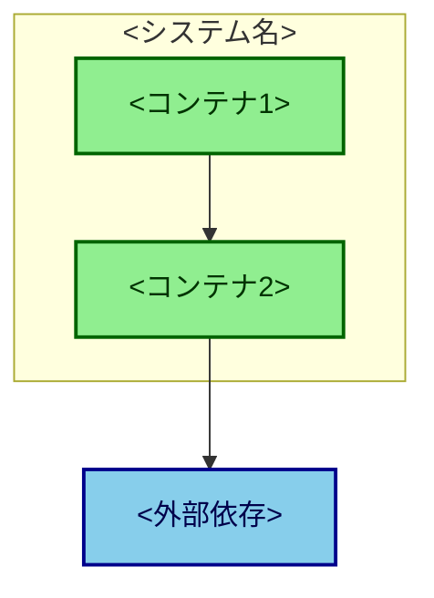

<!--
初回の design doc = システム全体の「なぜ」。追加only。書いたら二度と書き換えない。
以降の変更は docs/design/YYYY-MM-DD-<slug>.md を足す（design-doc-increment-template.md）。

書くべきか（Lynch の3問）:
  - 複数人で協調して実装するか
  - 3ヶ月以上の作業になるか
  - 数年本番で動くか
1つでも Yes なら書く価値がある。2つ以上なら確実に書くべき。0個なら書かない。

セクションはメニュー。「不要な節は削る」のが正しい使い方。全部埋めようとしない。
ただし選んだ節は、埋まらなくても空欄で残す。空欄が欠落を可視化する。
Open Issues の1行に畳むと穴が見えなくなる。

絵文字は使わない。図の色分けは classDef で行う。
-->

# Design Doc: <システム名>

## Metadata

| 項目 | 値 |
|---|---|
| 著者 |  |
| 作成日 | YYYY-MM-DD |
| ステータス | Draft / Approved |
| 対象システム |  |

## Objective

<!-- 1文。「何を」だけ書く。「どう作るか」（技術選択）は混ぜない。 -->

## Background

<!-- なぜ今これが必要なのか。数段落。ここは後から書けないので、決定の場で書く。 -->

## Goals

<!-- 達成したいこと。数字で書けるものは数字で。 -->

-

## Non-goals

<!--
やらないこと。ここが目的の drift を止める最も安い装置。
Plan mode やエージェントに渡す時、ここがスコープの境界として効く。
-->

-

## Glossary

<!-- 社内固有語・独自の略語。第三者が最初にぶつかる壁を下げる。 -->

| 用語 | 意味 |
|---|---|
|  |  |

## Architecture

<!--
決定時点の構成。「今の構成」は docs/architecture.md が持つのでここは更新しない。
C4 は Context と Container まで。Component 以下は変化が速いので書かない。
-->

### デプロイ単位

| デプロイ単位 | ディレクトリ | 実行環境 | 役割 |
|---|---|---|---|
|  |  |  |  |

### C4 — System Context

### C4 — Container

## Scenarios

<!--
ユーザー視点の使われ方。技術シーケンス図とは別物なので、シーケンス図があっても省略しない。
何をしたい人が、どう操作して、何を得るか。5〜7ステップ程度。
-->

1.

## Quality

<!--
品質目標。数字で書く。忘れられやすいので独立した節にしている（arc42 §10）。
数字が1つも無いなら、この節はまだ埋まっていない。分からないなら空欄で残す。
-->

| 観点 | 目標 | 根拠 |
|---|---|---|
| 可用性 |  |  |
| レイテンシ |  |  |
| 規模（利用者数・件数） |  |  |
| コスト |  |  |

## Risks and Technical Debt

<!--
分かっていて直していないこと。Open Issues（まだ決まっていないこと）とは別物。
引き継ぎでは負債一覧が最も価値が高いことがある。
-->

| # | 内容 | 影響 | 許容した理由 |
|---|---|---|---|
|  |  |  |  |

## Security & Privacy

<!-- 信頼境界・認証・機微データの扱い・想定する脅威とその緩和策。 -->

### 信頼境界と認証

-

### 想定する脅威

| # | 脅威 | 緩和策 |
|---|---|---|
|  |  |  |

### 機微データの扱い

-

## Constraints

<!-- 動かせない制約。実行環境の制限、外部システムの都合、組織の都合。 -->

-

## Alternatives Considered

<!--
却下した案とその理由。これは決定の場でしか書けない（後から書くと推定になる）。
書けないなら、まだ決定していない可能性がある。
-->

| 選択 | 採用理由 | 見送った代替 |
|---|---|---|
|  |  |  |

## Open Issues

<!-- まだ決まっていないこと。決まったら本文へ移し、ここから消す。 -->

| # | 論点 | 次アクション |
|---|---|---|
|  |  |  |

---

<!--
未確認の内容を書く場合は「推定」と明記し、Open Issues で追跡する。
doc の信頼性は「間違いを書かないこと」より「確認済みと推定を区別すること」で保たれる。
-->
