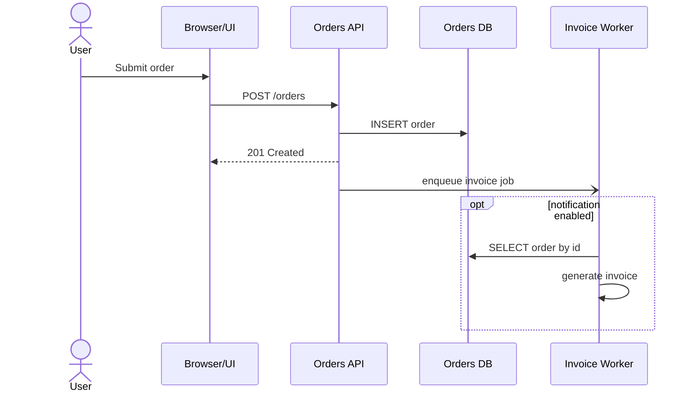

# Mermaid Sequence Diagram Rules

## 目的

第三者の開発者が、責務境界、時系列、同期/非同期、例外処理を誤読しないシーケンス図を残す。

- Mermaid は記法であり、考え方は UML sequence diagram に寄せる
- 図の目的は「詳細を全部描くこと」ではなく「実装責務と相互作用を明確にすること」

## いつ作るか

- API 呼び出し、キュー投入、Webhook、非同期ジョブなど、時系列が実装判断に直結するとき
- C4 だけでは、どこで待つか、分岐するか、再試行するかが伝わらないとき
- 開発者間で、境界や責務の誤読が起きやすいとき

## 作らないほうがよいとき

- 業務フローの全体像だけを共有したいとき
- 1 図で複数ユースケースを詰め込むしかないとき
- 相互作用ではなく構造説明が目的のとき

## 基本方針

- 1 図 1 シナリオ
- participant は責務単位
- メッセージは実装に近い具体名
- 成功系を先に固定し、例外系は必要に応じて分ける
- 同期と非同期を曖昧にしない

## participant の切り方

- `User`、`Browser/UI`、`API`、`Worker`、`DB`、`External API` のように責務境界で切る
- クラス単位やメソッド単位まで細かくしすぎない
- 1 図の participant は増やしすぎない

目安:

- 4 から 8 participant 程度に収める
- 9 を超えるなら図分割を優先する

## メッセージの書き方

- 動詞または操作名を含める
- API は `POST /orders` のように書く
- 非同期投入は `enqueue invoice job` のように書く
- DB は `SELECT order by id` のように、用途が分かる粒度で書く

避ける:

- `process`
- `request`
- `data`
- `call external`

## Combined Fragment の使い分け

- `alt`: 分岐。成功/失敗、条件差分
- `opt`: 任意処理。通知や監査記録など
- `loop`: 反復。リトライ、ページング、バッチ処理
- `par`: 並列。独立した並行実行
- `break`: 主シナリオを中断する異常系

条件は短いガードとして書く。

## 同期/非同期

- リクエストに対して待つ処理は同期として描く
- fire-and-forget、キュー投入、Webhook 待ちなどは非同期として描く
- 応答が後で返るなら、その戻りも明示する

## 例外処理

- 成功系と例外系を 1 図に混ぜすぎない
- 主経路理解が目的なら成功系を先に描く
- 重大な例外だけ `alt` または `break` で描く
- リトライやタイムアウトは `loop` と Note で補う

## Note の使い方

- 前提条件
- 冪等性
- トランザクション境界
- タイムアウト
- 再試行方針

図の主経路を邪魔しない範囲で短く書く。

## レビュー基準

- 1 図で 1 シナリオに絞れているか
- participant が責務単位になっているか
- メッセージが具体的で、実装担当が読んで判断できるか
- 同期/非同期、待機、戻りが曖昧でないか
- 分岐、反復、例外の表現が混線していないか
- 前提や制約が Note で補われているか

## 出力方針

- Mermaid を source of truth にする
- Markdown 内に fenced code block で置く
- 図の前に 2 から 4 行程度で目的と前提を書く

## 最低限のテンプレート

