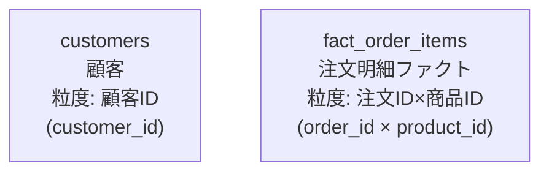
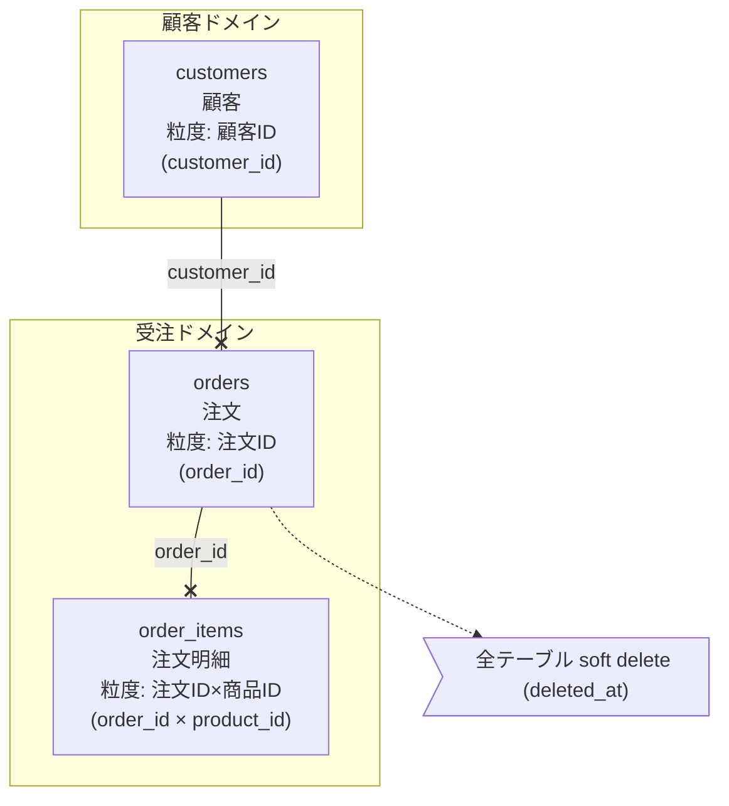
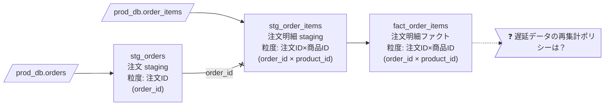

# Simple ER Diagram (Mermaid `flowchart` 流)

「正規の `erDiagram` だと窮屈」「ドメイン境界や粒度・補足ルールも一枚に書きたい」というときに使う、軽量 ER 図の描き方 Skill。

## When to Use

- 設計初期に **テーブル間の関係を素早く共有** したいとき
- データ基盤の **ソース → Staging → Mart のリネージ** を ER と一緒に表現したいとき
- **スタースキーマ** をファクト中心で図示したいとき
- ドメイン境界・粒度・未決事項・制約注釈を **同じ図に書き込みたい** とき
- ホワイトボード的に **会話しながら更新** していきたいとき

## Do Not Use

- 正規化レベル・カーディナリティの厳密性が求められる正式仕様書を作るとき
  → 厳密な `erDiagram` ブロックや dbdocs/SchemaSpy を使う
- DDL を直接生成したいとき
- 物理設計の最終成果物として残すとき（あくまで議論用スケッチ）

## Core Idea

**ER 専用記法 (`erDiagram`) ではなく、汎用 `flowchart` を使う。**

理由：

1. `subgraph` で **ドメイン境界をグルーピング** できる
2. ノード内に **改行・粒度・複合キー** など自由なテキストを書ける
3. **ER / リネージ / スタースキーマ** を同じ記法で統一表現できる
4. `note_>` / `todo_>` で **補足や未決事項** を同じ図に同居させられる

## Read Order

軽量 Skill のためサブファイルは持たない。下の "Node Convention" → "Relationship Convention" → "Templates" の順で読み、必要に応じて貼って書き換える。

---

## Node Convention

テーブル / モデルノードは **4 行構成** を基本とする。

```
table_name["table_name<br/>日本語名<br/>粒度: PK 説明<br/>(pk_column)"]
```

- 1 行目: 英語のテーブル名（実体名）
- 2 行目: 日本語の説明
- 3 行目: **粒度** を日本語で（"注文ID × 商品ID" など）
- 4 行目: PK カラムを括弧で囲む（複合キーは `×` で連結）

### 例



### ノード形状の使い分け

| 形状 | 構文 | 用途 |
|---|---|---|
| 標準四角形 | `name["..."]` | モデル / Mart テーブル |
| 平行四辺形 | `name[/"source.table"/]` | **ソーステーブル**（外部入力） |
| 非対称（note） | `note_xxx>"..."]` | ルール・制約の注釈 |
| 非対称（todo） | `todo_xxx>"❓ ..."]` | **未決事項** |

---

## Relationship Convention

### ER 図モード（構造表現 / `TD` 推奨）

| 関係 | 記法 |
|---|---|
| 1 対 N（必須） | `parent --x\|join_key\| child` |
| 1 対 N（任意） | `parent --o\|join_key\| child` |

`x` は必須、`o` はオプショナル、というイメージで覚える。
**join キーは必ずラベルに書く**（後から読む人のため）。

### リネージモード（変換フロー / `LR` 推奨）

| 関係 | 記法 |
|---|---|
| 変換フロー | `source --> staging` |
| JOIN 関係 | `a --x\|join_key\| b` |

ER と同じ JOIN 記法を使えるので **同一図でリネージと結合関係を同居** できる。

---

## Domain Grouping & Annotations

### ドメイン境界

```
subgraph sales["売上ドメイン"]
    orders["..."]
    fact_order_items["..."]
end
```

`subgraph` 名は英語キー＋日本語表示名にしておくと、後で参照しやすい。

### 制約・ルール注釈

```
note_soft_delete>"soft delete: deleted_at IS NULL を常時付与"]
fact_order_items -.-> note_soft_delete
```

破線 (`-.->`) で「ノードに付随するメモ」であることを表す。

### 未決事項

```
todo_grain>"❓ 返品は別ファクトに分ける？"]
fact_order_items -.-> todo_grain
```

`❓` プレフィックス + `todo_` 命名で、後でレビューすべき箇所を一目で見つけられる。

---

## Style & Direction

- **スタイルは Mermaid デフォルトのまま** にする（色やクラス定義で消耗しない）
- 方向は用途で使い分ける:
  - `TD` … ER 構造、スタースキーマ（中心に向けて寄せる）
  - `LR` … リネージ・処理フロー（左→右に流す）

---

## Templates

### Template 1: 簡易 ER 図（ドメイン境界つき）



### Template 2: データリネージ（Source → Staging → Mart）



### Template 3: スタースキーマ（ファクト中心）

```mermaid
flowchart TD
    fact["fact_sales<br/>売上ファクト<br/>粒度: 注文ID×商品ID<br/>(order_id × product_id)"]

    dim_customer["dim_customer<br/>顧客ディメンション<br/>粒度: 顧客ID<br/>(customer_id)"]
    dim_product["dim_product<br/>商品ディメンション<br/>粒度: 商品ID<br/>(product_id)"]
    dim_date["dim_date<br/>日付ディメンション<br/>粒度: 日付<br/>(date_id)"]
    dim_store["dim_store<br/>店舗ディメンション<br/>粒度: 店舗ID<br/>(store_id)"]

    dim_customer --x|customer_id| fact
    dim_product  --x|product_id|  fact
    dim_date     --x|date_id|     fact
    dim_store    --o|store_id|    fact
```

---

## Authoring Checklist

図を出す前に最低限これだけ確認する:

- [ ] 各ノードに **粒度 (PK)** が書かれているか
- [ ] **複合キー** は `×` で連結されているか
- [ ] 関係線に **join キーラベル** がついているか
- [ ] 必須/任意を `x` / `o` で区別したか
- [ ] **ドメイン境界** が `subgraph` で表現されているか
- [ ] 制約や未決事項が `note_>` / `todo_>` で図中に残っているか
- [ ] 方向は構造なら `TD`、フローなら `LR` になっているか
- [ ] Mermaid デフォルトスタイルのまま（色装飾で消耗していない）か

---

## Anti-Patterns

- 厳密な `erDiagram` 構文に切り替えてしまい、ドメイン境界や注釈を諦める
- ノードに **粒度を書かず** テーブル名だけにする（一番事故りやすい）
- JOIN キーをラベルではなく **線種だけ** で表現してしまい、読み手に推測させる
- 色クラスを大量定義して **見た目で消耗** する
- 未決事項を別ドキュメントに分離してしまい、図と乖離する
  → `todo_>` で同居させ続けることが Skill の肝

---

## References

- 元記事: [Mermaid データモデル図記法ガイド (zenn / yuichi_dev)](https://zenn.dev/yuichi_dev/articles/217f4d3165d59f)
- 関連 Skill: `dx-diagram-skill`（業務フロー / C4 / Sequence など、より重いドメインの図解）

---

*簡易 ER 図はあくまで会話のための道具。厳密性より「同じ一枚で議論できること」を優先する。*
